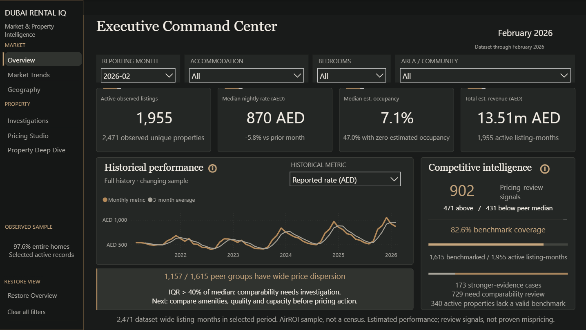
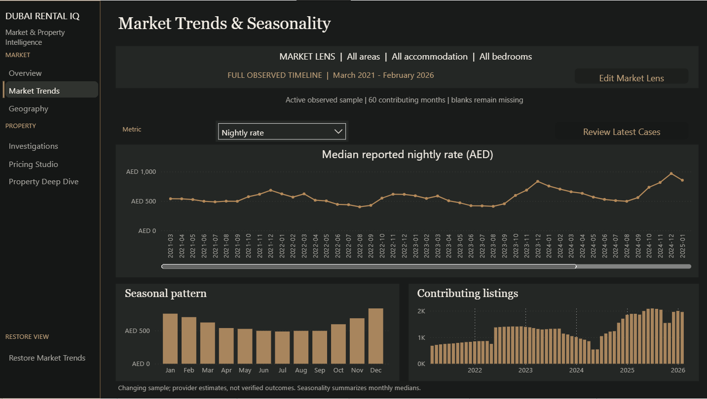
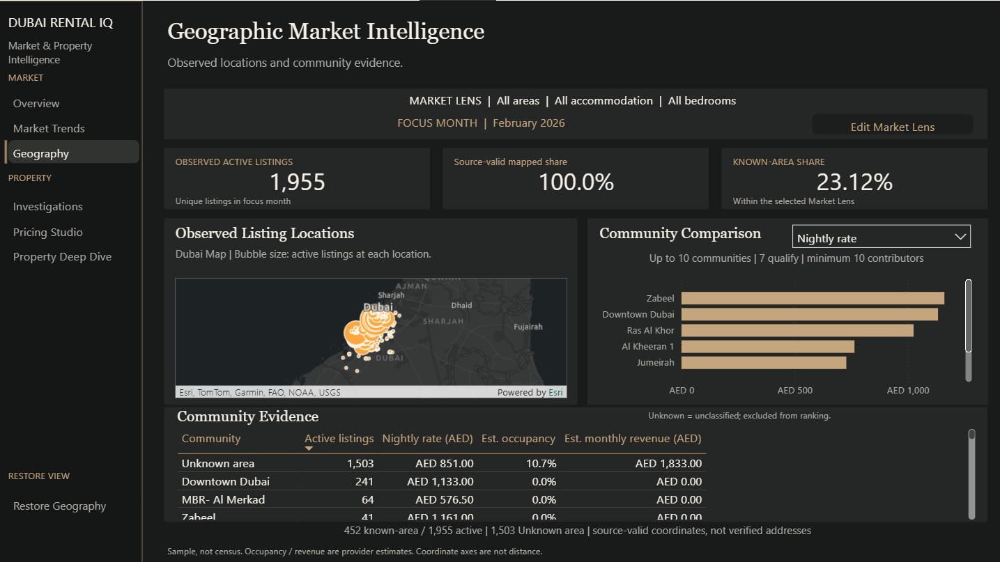
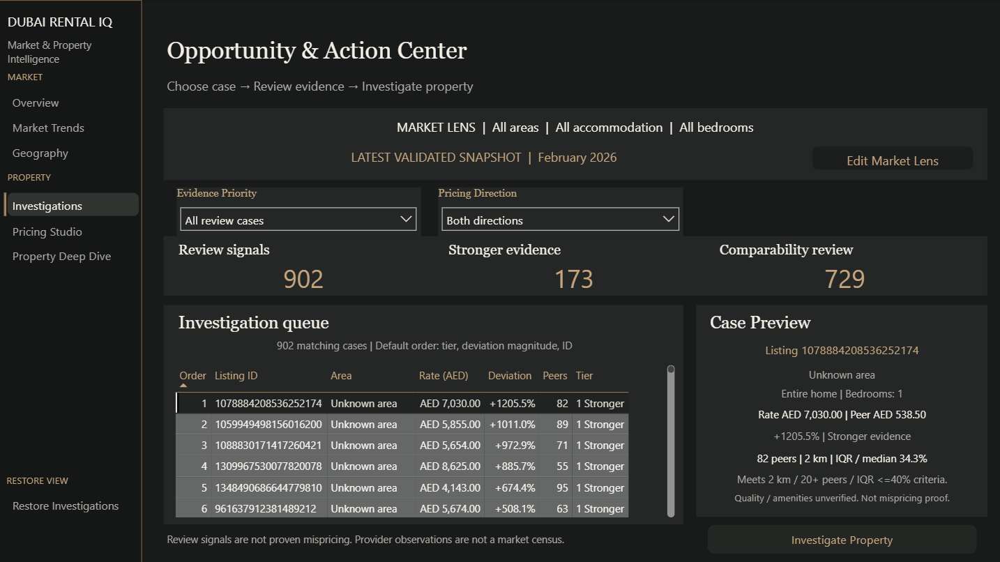
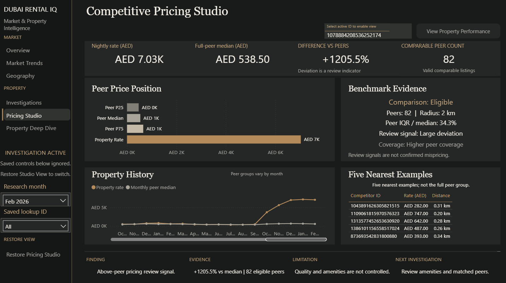
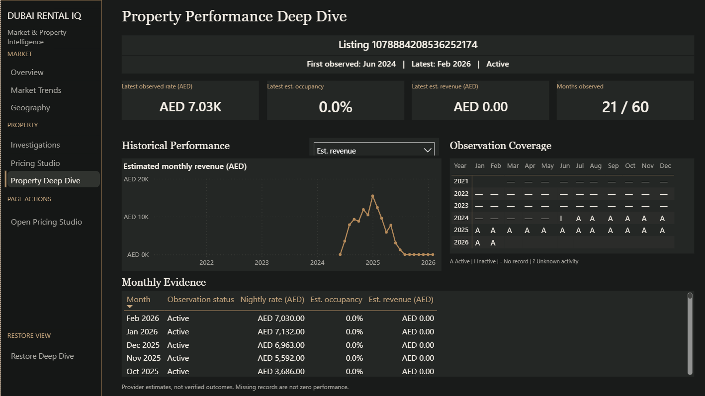

# Dubai Rental IQ

**Six connected Power BI workspaces for market monitoring, pricing review and property history.**

Dubai Rental IQ helps an analyst move from a historical market snapshot to a property requiring review, examine its comparable-peer evidence, and inspect its observed performance history. It combines Python preparation and geographic matching, SQLite analysis, and a native Power BI application with an Obsidian Luxury interface.

The dashboard is implemented. Its findings describe an **AirROI-derived sample from March 2021 to February 2026**, not current market conditions, a Dubai rental census, verified bookings or realized income.

## Explore the application

| Workspace | Main question |
|---|---|
| **Overview — Executive Command Center** | What does the selected market segment and reporting month show? |
| **Market Trends & Seasonality** | How do reported rates, estimated performance and sample coverage vary over 60 months? |
| **Geography — Geographic Market Intelligence** | Where are observed listings located, and how do communities compare? |
| **Investigations — Opportunity & Action Center** | Which latest-snapshot pricing-review cases warrant examination? |
| **Competitive Pricing Studio** | How does one explicitly selected property compare with its full eligible peer group? |
| **Property Performance Deep Dive** | How has that property's recorded performance evolved, including missing months? |

The main property workflow is **Investigations → Pricing Studio → confirm listing → Property Deep Dive**. Direct Research provides an alternative entry through Studio. Overview owns the shared Market Lens; page-specific month and property contexts remain separate. See the [User Guide](docs/USER_GUIDE.md).

## Portfolio walkthrough

Read the [portfolio case study](docs/PORTFOLIO_CASE_STUDY.md) for the business problem, engineering decisions, six-page walkthrough and demonstrated skills. The project combines independent source reconciliation, geographic peer benchmarking, explicit property handoffs and honest missing-month evidence.

**Six owner-approved screenshots are available below.** Captions describe the actual captured states; public-use rights and identifier exposure remain subject to owner review.

**Overview → Market Trends → Geography → Investigations → Pricing Studio → Property Deep Dive**

### Executive Command Center



*The executive snapshot establishes the active sample and benchmark coverage before deeper analysis.*

### Market Trends & Seasonality



*Historical rates are read alongside seasonality and changing sample coverage; the main chart has a scrollable viewport.*

### Geographic Market Intelligence



*Source-valid listing locations are mapped without hiding the large Unknown-community share. Esri and map-provider credits remain visible.*

### Opportunity & Action Center



*The 902-case review queue connects a selected case’s evidence to property investigation.*

### Competitive Pricing Studio



*One property is assessed against full-peer evidence, with history and nearest examples kept distinct.*

### Property Performance Deep Dive



*The selected property’s revenue history, 21/60 observed months and explicit observation states distinguish missing evidence from recorded zeros.*

The [publication notes](docs/PUBLICATION_NOTES.md) define the proposed code/project allowlist, private-data exclusions, screenshot checklist and unresolved rights/privacy decisions. The isolated package is technically prepared; third-party rights remain subject to owner review before upload.

## Verified sample findings

These figures reuse the existing numerical audits; they are not new claims of business impact.

| Evidence | Result |
|---|---:|
| Historical records / distinct listings / reporting months | 99,745 / 4,364 / 60 |
| February 2026 observed / active listings | 2,471 / 1,955 |
| February active listings with eligible peer benchmarks | 1,615 |
| Latest pricing-review queue | 902 cases: 173 stronger-evidence and 729 comparability-review |
| February active listings with source-valid coordinates | 1,955 across 1,782 coordinate groups |
| February active listings with known historical area | 452 (23.12%); 1,503 classified Unknown area |

Review signals identify investigation candidates, not proven mispricing. Five Nearest Examples are illustrations; benchmark medians and quartiles use the full eligible peer population. ArcGIS bubbles use graduated listing-count classes, with exact counts in tooltips.

## Architecture and workflow

```text
Four provider source files
  → Python validation, historical facts/dimensions and peer matching
  → SQLite analytical views and independent reconciliation
  → private model import files
  → Power BI TMDL semantic model + PBIR report
  → six connected analytical workspaces
```

Python preserves the listing-month grain and computes same-month geographic peer sets. SQL supplies analytical views and review classifications. Power BI provides context-aware measures, synchronized market controls, guarded property handoffs, complete historical calendars and interactive evidence.

The eight [notebooks](notebooks/README.md) explain the analytical pipeline; [SQL documentation](sql/README.md) explains its relational layer. Dependencies are listed in `requirements.txt`; `requirements-lock.txt` records the tested environment and includes platform-specific packages. Earlier pipeline execution evidence is summarized in [Validation Summary](VALIDATION_SUMMARY.md); private originals remain local.

## Open the project safely

The report entry point is [powerbi/DubaiRentalIntelligence.pbip](powerbi/DubaiRentalIntelligence.pbip). Use Power BI Desktop with the existing report/model folders and authorized local imports. Preserve any open unsaved work before switching projects.

**A fresh checkout is not immediately runnable.** Provider data, generated imports, local path configuration, model caches, PBIX files and proprietary native-query libraries are intentionally excluded. Obtain data rights and prepare a separate local environment before attempting reproduction. See [Power BI opening requirements](powerbi/README.md#opening-requirements).

Do not run the legacy global report or semantic-model generators over the accepted project. They are development artifacts, not a supported way to recreate its final manual formatting and interactions. Documentation work does not require refreshing or rebuilding anything.

## Documentation and evidence

- [Portfolio Case Study](docs/PORTFOLIO_CASE_STUDY.md): problem, architecture, decisions and six-page walkthrough.
- [Publication Notes](docs/PUBLICATION_NOTES.md): candidate files, exclusions, attribution and pending approvals.
- [Local Setup](docs/SETUP.md): Python requirements, lawful inputs and the data-only twelve-file exporter.
- [User Guide](docs/USER_GUIDE.md): navigation, filters, handoffs, restores and missing states.
- [Methodology](docs/METHODOLOGY.md): metric populations, source limitations, peer rules and geography.
- [Data Dictionary](docs/DATA_DICTIONARY.md): saved-model tables, relationships, selectors and important measures.
- [Validation and performance evidence](VALIDATION_SUMMARY.md): dated analytical checks, functional acceptance, owner-confirmed workflows, measured-performance scope and remaining gaps. Historical reports remain local pending sanitization.

Automated/static checks, native execution and owner-confirmed behavior are different evidence categories. Historical assertion totals overlap and must not be added together or treated as proof of every current runtime interaction.

## Limitations and publication

Occupancy and revenue are provider estimates. Sample composition changes over time; undated property metadata is not historical evidence. Source coordinate bounds do not verify addresses or community boundaries. Known-area comparisons cover a minority of February's active sample. Peer matching does not control for every quality, capacity or amenity difference. Missing records do not mean closure or zero revenue.

Remaining review items include geographic/provider uncertainty, a future-null zero-count caveat, and untested native edge cases. See [Methodology](docs/METHODOLOGY.md#remaining-limitations-and-evidence).

Dataset redistribution and ArcGIS screenshot/public-display rights remain unresolved. Do not publish private imports, caches, listing-level exports, audit recordings, credentials or local configuration. An author-code license would not grant rights to third-party data, map tiles or imagery. This documentation does not claim a public deployment or publication clearance.

Source attribution: [AirROI — Airbnb Short-Term Rental Data: Dubai](https://www.kaggle.com/datasets/jasonairroi/airbnb-short-term-rental-data-dubai) and [AirROI methodology](https://www.airroi.com/data-portal/methodology). These references identify provenance; their presence is not a redistribution license or endorsement.

## License and reproduction

The [MIT license](LICENSE) covers only the author’s original code, not provider datasets, map imagery, vendor assets or proprietary software. The six approved screenshots and analytical examples are retained by owner decision; underlying third-party rights remain unresolved. See [publication notes](docs/PUBLICATION_NOTES.md).

For lawful local reproduction, use **Python 3.11+** (the existing audit environment was Python 3.12.14, not a new clean-install test). Follow [Local Setup](docs/SETUP.md): obtain the four source files, run preparation/peer/SQLite stages, then `src/08_export_model_imports.py --expect-reference` to generate all twelve final imports. Configure the blank `DataFolder` parameter to the parent of `model/` in a local Power BI working copy. No data or populated model cache is supplied; do not regenerate the finalized report. Generated files and notebook outputs must remain private until separately reviewed.

This is an independent portfolio project with no implied affiliation or endorsement. The original AirROI dataset is not included or redistributed. The approved screenshots retain Esri and applicable map-provider credits; attribution alone does not establish publication permission.
